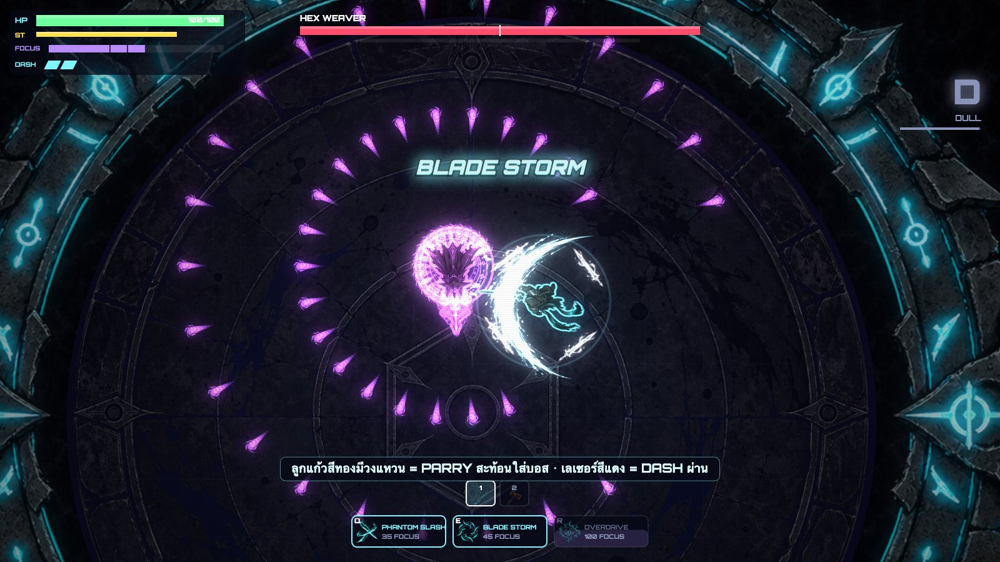
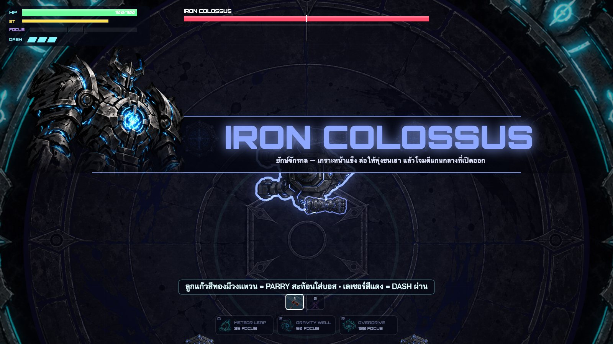
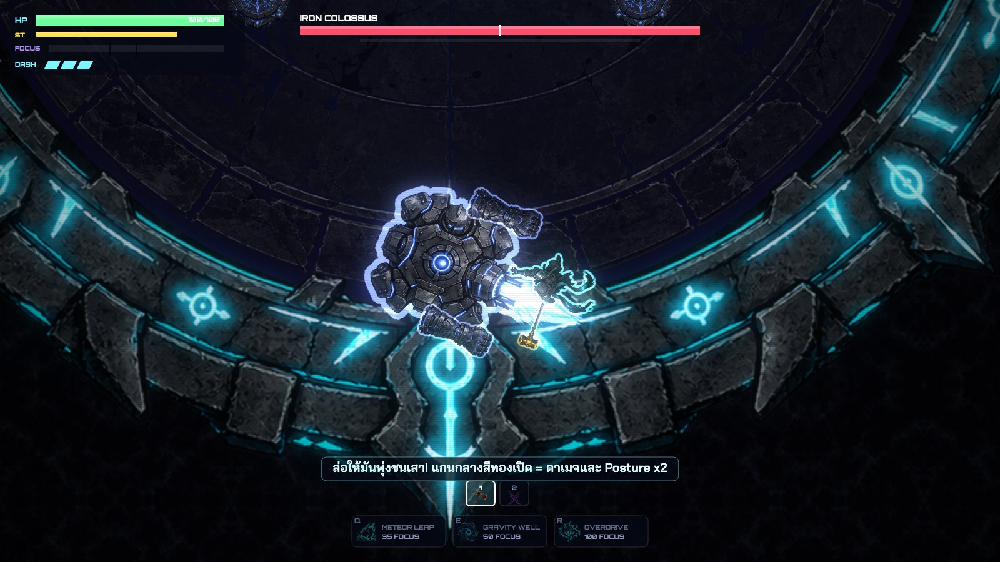

# NEON DUEL — Arena of Echoes

เกมต่อสู้ในสนามประลอง 2D มุมมองบน เล่นบนเว็บเบราว์เซอร์ เน้นการเคลื่อนที่ จังหวะ และความลื่นไหล
หลบด้วย Dash ปัดป้องด้วย Parry ต่อคอมโบ แล้วฝ่าบอส 5 ตัวที่แต่ละตัวมีกลไกไม่เหมือนกัน
ภาพสไตล์ **Ink & Neon** คือตัวละครเป็นหมึกดำแบบพู่กันญี่ปุ่น ตัดด้วยเส้นนีออนเรืองแสง



| เปิดตัวบอส | ต่อสู้ |
|---|---|
|  |  |

---

## จุดเด่น

- **ระบบต่อสู้ที่ให้รางวัลกับความแม่นยำ**
  - คอมโบหลายจังหวะ กดล่วงหน้าได้ (input buffer) และยกเลิกท่าด้วย Dash ได้
  - **Perfect Dodge**: Dash ฉิวเฉียดการโจมตี เวลาจะช้าลง คืนชาร์จ Dash และได้ Focus
  - **Parry**: กดป้องกันพอดีจังหวะเพื่อสะท้อนกระสุนหรือทำให้ศัตรูเสียหลัก แล้วสวนกลับแรงขึ้น 2.2 เท่า
  - **Posture / Stagger / Execute**: ทำลายแถบ Posture ของบอสจนมึน แล้วใช้ท่าประหาร
- **อาวุธ 3 แบบ** ได้แก่ Katana, Twin Fangs (มีดคู่) และ Graviton (ค้อน) แต่ละแบบมีคอมโบ ท่าชาร์จ และสกิล Q/E ของตัวเอง สลับกลางคอมโบได้ และใช้ **Overdrive** ร่วมกัน
- **บอส 5 ตัว** มี 2 เฟสทุกตัว และแต่ละตัวสอนกลไกใหม่

  | บอส | กลไกหลัก |
  |---|---|
  | The Vanguard | โล่ด้านหน้า ต้อง Parry หรืออ้อมไปด้านหลัง |
  | Hex Weaver | ห่ากระสุน ต้อง Dash ทะลุและสะท้อนลูกแก้วทอง |
  | Twin Fangs | สู้สองตัวพร้อมกัน ฆ่าตัวหนึ่งแล้วอีกตัวจะคลั่ง |
  | Iron Colossus | เกราะหน้าแข็ง ต้องล่อให้พุ่งชนเสาเพื่อเปิดแกนกลาง |
  | Mirror Sovereign | เงาสะท้อนของผู้เล่น ลอกสกิลที่คุณใช้บ่อยที่สุด |

- **Roguelite แบบเบา ๆ**: มีด่านศัตรูคั่นระหว่างบอส เลือกการ์ดอัปเกรดหลังทุกด่าน (28 ใบ 4 ระดับความหายาก) มี Style Rank ตั้งแต่ D ถึง SSS โหมด Hard และบันทึกสถิติที่ดีที่สุด
- **เอฟเฟกต์**: hit-stop, จอสั่น, slow-mo, bloom, แฟลช, ภาพเงาตอนพุ่ง และแอนิเมชันด้วยโค้ดที่ทำให้ภาพนิ่งดูมีชีวิต
- **เสียง**: เพลง synthwave และเสียงประกอบสังเคราะห์ด้วย Web Audio ใส่ไฟล์เสียงจริงแทนได้
- **Endless Mode**: สู้ไม่สิ้นสุด ศัตรูแกร่งขึ้นทุกรอบ บอสทุก 5 รอบ, GAUNTLET สองบอสทุก 10 รอบ และ Affix สุ่ม (รายละเอียดใน [docs/ENDLESS.md](docs/ENDLESS.md))
- **Leaderboard ออนไลน์**: ส่งคะแนนพร้อมภาพหน้าจอตอนจบรอบ เก็บบน Neon Postgres และ Neon Object Storage

## วิธีรัน

ต้องมี [Node.js](https://nodejs.org/) เวอร์ชัน 18 ขึ้นไป

```bash
npm install
npm run dev
```

แล้วเปิด http://localhost:5173

| คำสั่ง | ใช้ทำอะไร |
|---|---|
| `npm run dev` | รันเซิร์ฟเวอร์สำหรับพัฒนา (ซิงก์ภาพอัตโนมัติ ดูหัวข้อ "งานศิลป์") |
| `npm run build` | ตรวจ type แล้ว build เป็นเว็บ static ใน `dist/` นำไปโฮสต์ที่ไหนก็ได้ |
| `npm run preview` | เปิดดูผลจาก `dist/` |
| `npm run assets` | นำเข้าภาพจากโฟลเดอร์งานศิลป์ (`-- --force` = นำเข้าใหม่ทั้งหมด) |
| `npm run remove-bg -- <ไฟล์หรือโฟลเดอร์>` | ลบพื้นหลังภาพ ผลลัพธ์อยู่ใน `_transparent/` |

**ลัดไปด่านที่ต้องการ (สำหรับซ้อม):** รอบที่เริ่มกลางเกมจะไม่ถูกบันทึกลง leaderboard · Endless ใช้ `?mode=endless&stage=19` (เริ่มรอบ 20) · `http://localhost:5173/?stage=7&weapon=hammer&hard=1` (ด่าน 0–9)

## Leaderboard ออนไลน์ (Neon)

เกมรันได้แบบ static ไม่มี backend ก็ได้ ส่วน leaderboard จะซ่อนตัวเองอัตโนมัติ ถ้าต้องการ leaderboard ให้รันพร้อมเซิร์ฟเวอร์ API (`server/`)

| ส่วน | ใช้ทำอะไร |
|---|---|
| **Neon Postgres** | ตาราง `runs` เก็บชื่อ คะแนน ด่าน อาวุธ เวลา และสถิติ ([migrations/](migrations/)) เชื่อมด้วย `pg` ผ่าน `DATABASE_URL` (pooled) |
| **Neon Object Storage** | bucket `assets` เก็บภาพหน้าจอตอนจบรอบ (`runs/<id>.jpg`) ใน Postgres เก็บแค่ key แล้วส่ง presigned URL ให้ผู้เล่น |

**ตั้งค่าครั้งแรก**

```bash
npm i -g neon                 # Neon CLI
neon deploy                   # สร้าง service ตาม neon.ts แล้วดึง env vars ลง .env.local
npm run db:migrate            # สร้างตาราง (ใช้ DATABASE_URL_UNPOOLED)
```

- **รันตอนพัฒนา:** `npm run dev` มี API ที่ `/api/*` ในตัว
- **รันแบบ production:** `npm run build && npm start` เซิร์ฟเวอร์ Node ตัวเดียวเสิร์ฟทั้งเกมและ API (พอร์ต `PORT` ค่าเริ่มต้น 3000)

| Endpoint | หน้าที่ |
|---|---|
| `GET /api/health` | ทดสอบ Postgres และ Object Storage (เขียน/อ่าน/ลบ) |
| `GET /api/leaderboard?hard=0&limit=10` | อันดับสูงสุด พร้อมลิงก์ภาพหน้าจอ |
| `POST /api/scores` | ส่งผลรอบ (คะแนนคำนวณฝั่งเซิร์ฟเวอร์ มีตรวจข้อมูลและจำกัดความถี่ต่อ IP) |

> `.env.local` มีรหัสผ่านฐานข้อมูลและคีย์ storage — อยู่ใน `.gitignore` แล้ว ห้าม commit

## การควบคุม

| ปุ่ม | การกระทำ |
|---|---|
| `W` `A` `S` `D` | เคลื่อนที่ |
| เมาส์ | เล็ง |
| คลิกซ้าย | โจมตี (กดต่อเนื่อง = คอมโบ) · กดค้าง = ท่าชาร์จ |
| คลิกขวา / `Shift` | แตะพอดีจังหวะ = **Parry** · กดค้าง = Block |
| `Space` | **Dash** (อมตะชั่วขณะ) |
| `Q` / `E` | สกิลพิเศษ (ใช้ Focus) |
| `R` | Overdrive (เมื่อ Focus เต็ม) |
| `1` `2` `3` | สลับอาวุธ |
| `Esc` | พักเกมและตั้งค่า |

**ภาษาสีในเกม:** สีส้ม = Parry/Block ได้ · สีแดง = ป้องกันไม่ได้ ต้อง Dash หนี · วงแหวนทองบนกระสุน = สะท้อนกลับได้

## โครงสร้างโปรเจกต์

เขียนด้วย TypeScript + Canvas 2D บน Vite โดยไม่ใช้ game engine

```
src/
  core/      input (มี buffer), math, coroutine runner สำหรับสคริปต์ท่าบอส
  render/    renderer (bloom / post-fx), camera, fx (particle / slash / ring),
             sprites (โหลดภาพ + fallback), procanim (แอนิเมชันด้วยโค้ด)
  audio/     เสียงประกอบและเพลงสังเคราะห์ รองรับไฟล์จริงผ่าน manifest
  game/      world (hitbox / projectile / time-scale), player, weapons, enemies,
             bosses/, upgrades, style rank, run (ลำดับด่าน)
  ui/        hud (วาดบน canvas), menus (DOM), gallery (หน้าตรวจภาพ), style.css
  net/       client ของ leaderboard API
  assets/sprites/   ภาพที่นำเข้าแล้ว พร้อมใช้ในเกม
server/      API leaderboard (Neon Postgres + Object Storage) และเซิร์ฟเวอร์ production
migrations/  SQL schema
neon.ts      ประกาศ service ของ Neon (infrastructure as code)
tools/
  migrate.mjs         รัน migration
  import-assets.mjs   นำเข้าภาพ: ครอป จัดจุดกลางลำตัว ปรับสเกลตาม hitbox
  bg-remove.mjs       ลบพื้นหลัง (แบบรักษาแสงเรืองสำหรับ VFX / แบบ flood-fill สำหรับภาพทึบ)
```

- ปรับจังหวะการต่อสู้ได้ที่ frame data ใน `src/game/weapons.ts`
- ท่าของบอสอยู่ใน `src/game/bosses/*.ts` เขียนเป็น generator อ่านง่ายทีละขั้น

## งานศิลป์

- **ระบบภาพ:** วาง PNG ตามชื่อช่องลงใน `src/assets/sprites/` ภาพไหนไม่มี เกมจะวาดกราฟิกนีออนด้วยโค้ดแทน
- **หน้าตรวจภาพ:** เปิด `?sprites=1` เพื่อดูว่าช่องไหนมีภาพแล้ว พร้อมพรีวิวแอนิเมชัน
- **ซิงก์อัตโนมัติ:** ตั้งโฟลเดอร์ต้นทางใน `assets.config.json` (ค่าเริ่มต้นคือ `../Asset`) ระหว่าง `npm run dev` ภาพใหม่จะถูกนำเข้า ลบพื้นหลัง ครอป และปรับขนาดให้เอง
- **ปรับรายภาพ:** ขนาดหรือจุดหมุนปรับได้ใน `tools/asset-tweaks.json`
- **เอกสารเพิ่มเติม:**
  - [ASSETS.md](ASSETS.md): แนวทางภาพ รายการ asset ทั้งหมด และสเปก
  - [ART_PROMPTS.md](ART_PROMPTS.md) + [art_prompts.json](art_prompts.json): prompt สำหรับ generate ภาพทั้ง 159 ภาพ
- **ใส่เสียงจริง:** วางไฟล์ใน `public/assets/audio/` แล้วระบุชื่อไฟล์ใน `manifest.json` (ชื่อเสียงที่รองรับดูได้ที่ type `Sfx` ใน `src/audio/audio.ts`)

## License

- **โค้ด:** [MIT License](LICENSE) นำไปใช้ แก้ไข และเผยแพร่ได้อย่างอิสระ
- **งานศิลป์ ภาพ โลโก้ และชื่อ "NEON DUEL":** สงวนลิขสิทธิ์ทั้งหมด (All Rights Reserved) ดู [ASSETS-LICENSE.md](ASSETS-LICENSE.md)

ถ้าจะ fork โค้ดไปทำเกมของตัวเอง ให้แทนที่ภาพใน `src/assets/sprites/` ด้วยงานของคุณเอง เกมรันได้แม้ไม่มีภาพเลย

---

พัฒนาโดย [@Thatsadon9](https://github.com/Thatsadon9) ร่วมกับ [Claude Code](https://claude.com/claude-code)
